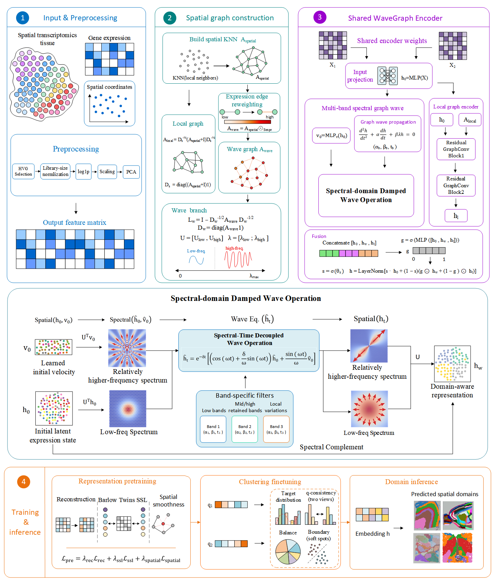

# STWaveGraph: Spatial Domain Identification in Spatial Transcriptomics via Multi-Band Damped Graph Wave Propagation

## Overview

Spatial transcriptomics (ST) enables transcriptome-wide molecular profiling while preserving the spatial organization of tissue sections. Accurately identifying spatial domains is a fundamental task for understanding tissue architecture, cellular neighborhoods, and disease-associated microenvironments. However, existing graph-based methods often rely on repeated neighborhood aggregation, which may behave like diffusion-like smoothing and blur sharp molecular transitions at anatomical or pathological boundaries.

**STWaveGraph** is a frequency-adaptive graph spectral learning framework designed for robust and boundary-aware spatial domain identification in spatial transcriptomics. It features:

- **Expression-Reweighted Wave Graph:** Constructs spatial graphs from physical coordinates and reweights spatial edges using transcriptomic similarity, reducing potential cross-boundary signal mixing between transcriptionally dissimilar neighboring spots or cells.
- **Multi-Band Damped Graph Wave Propagation:** Introduces a graph spectral propagation module based on damped wave dynamics. Unlike conventional diffusion-like graph aggregation, STWaveGraph allows retained spectral components to follow learnable band-specific propagation behaviors, capturing both smooth tissue-level organization and localized spatial transitions.
- **Residual Local Graph Encoder:** Preserves short-range spatial continuity and neighborhood-level coherence through a residual graph convolutional branch, complementing the spectral wave branch.
- **Adaptive Spectral-Local Fusion:** Combines the spectral wave representation, local graph representation, and initial latent features through a learnable fusion mechanism to balance global graph spectral structure and local spatial consistency.
- **Boundary-Aware Clustering Refinement:** Optimizes spatial domain embeddings through representation pretraining and clustering-oriented fine-tuning, including reconstruction, cross-view consistency, spatial coherence, clustering alignment, cluster balance, and boundary-aware regularization.



## Installation

We recommend using [Conda](https://docs.conda.io/en/latest/) to manage your environment. STWaveGraph is implemented in Python and relies on PyTorch, Scanpy, Anndata, Rpy2, and common scientific computing packages.

## Installation

The following commands set up the core STWaveGraph model and tutorials
on Linux. Python dependencies are specified in
`STWaveGraph-main/requirements.txt`.

```bash
git clone https://github.com/JiruiZhang/STWaveGraph.git
cd STWaveGraph

conda create -n stwavegraph -c conda-forge \
  python=3.8 pip r-base=4.0.3 \
  c-compiler cxx-compiler fortran-compiler
conda activate stwavegraph

export R_HOME="$(R RHOME)"

python -m pip install torch==2.4.1 \
  --index-url https://download.pytorch.org/whl/cu124

Install mclust 6.0.0:

```bash
Rscript -e 'install.packages("https://cran.r-project.org/src/contrib/Archive/mclust/mclust_6.0.0.tar.gz", repos=NULL, type="source")'
```

Verify the installation:

```bash
python -m pip check
Rscript -e 'library(mclust); print(packageVersion("mclust"))'
python -c "import torch, scanpy, rpy2.robjects; print(torch.__version__); print('CUDA available:', torch.cuda.is_available())"
```


### Historical tutorials and saved outputs

| Notebook | Dataset |
| --- | --- |
| [DLPFC_151673.ipynb](STWaveGraph-main/DLPFC_151673.ipynb) | DLPFC section 151673 |
| [Breast.ipynb](STWaveGraph-main/Breast.ipynb) | Human breast cancer |
| [MouseBrain.ipynb](STWaveGraph-main/MouseBrain.ipynb) | Mouse brain |
| [osmFISH.ipynb](STWaveGraph-main/osmFISH.ipynb) | osmFISH |
| [MERFISH.ipynb](STWaveGraph-main/MERFISH.ipynb) | MERFISH |
| [STARmap.ipynb](STWaveGraph-main/STARmap.ipynb) | STARmap |
