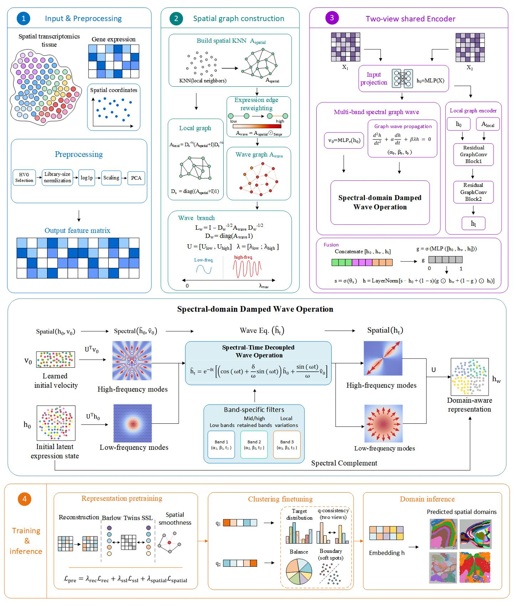

# STWaveGraph Combines Damped Spectral Responses and Local Encoding for Spatial Domains

## Overview

STWaveGraph is a graph spectral learning framework for spatial domain identification in spatial transcriptomics. It combines multiband damped spectral responses with residual local encoding to capture tissue organization across spatial scales.

The framework includes:

- **Expression-weighted spatial graph:** Constructs a spatial neighborhood graph and weights its edges using gene-expression similarity.
- **Damped spectral filtering:** Learns band-specific state and velocity responses on selected graph modes.
- **Residual local encoding:** Captures local neighborhood information through a residual graph convolutional branch.
- **Adaptive feature fusion:** Integrates spectral features, local features, and initial representations.
- **Representation learning and clustering:** Uses representation pretraining and clustering-oriented fine-tuning to identify spatial domains.

Evaluation combines global clustering metrics, exact-edge interface measurements, and localized cortical overlap analysis. This repository provides the core implementation, dataset notebooks, experiment scripts, configurations, and selected results.



## Installation

We recommend using [Conda](https://docs.conda.io/en/latest/) to manage your environment. STWaveGraph is implemented in Python and relies on PyTorch, Scanpy, Anndata, Rpy2, and common scientific computing packages.

## Installation

The following commands set up the core STWaveGraph model and tutorials
on Linux. Python dependencies are specified in
`STWaveGraph-main/requirements.txt`.

```bash
git clone https://github.com/JiruiZhang/STWaveGraph.git
cd STWaveGraph

conda create -n stwavegraph -c conda-forge \
  python=3.8 pip r-base=4.0.3 \
  c-compiler cxx-compiler fortran-compiler
conda activate stwavegraph

export R_HOME="$(R RHOME)"

python -m pip install torch==2.4.1 \
  --index-url https://download.pytorch.org/whl/cu124

Install mclust 6.0.0:

```bash
Rscript -e 'install.packages("https://cran.r-project.org/src/contrib/Archive/mclust/mclust_6.0.0.tar.gz", repos=NULL, type="source")'
```

Verify the installation:

```bash
python -m pip check
Rscript -e 'library(mclust); print(packageVersion("mclust"))'
python -c "import torch, scanpy, rpy2.robjects; print(torch.__version__); print('CUDA available:', torch.cuda.is_available())"
```

### Experiments and results

- [Experiment files and commands](STWaveGraph-main/experiments/README.md)
- [Result tables and plotting script](STWaveGraph-main/results)

The installation above covers STWaveGraph and its experiment utilities.
### Historical tutorials and saved outputs

| Notebook | Dataset |
| --- | --- |
| [DLPFC_151673.ipynb](STWaveGraph-main/DLPFC_151673.ipynb) | DLPFC section 151673 |
| [Breast.ipynb](STWaveGraph-main/Breast.ipynb) | Human breast cancer |
| [MouseBrain.ipynb](STWaveGraph-main/MouseBrain.ipynb) | Mouse brain |
| [osmFISH.ipynb](STWaveGraph-main/osmFISH.ipynb) | osmFISH |
| [MERFISH.ipynb](STWaveGraph-main/MERFISH.ipynb) | MERFISH |
| [STARmap.ipynb](STWaveGraph-main/STARmap.ipynb) | STARmap |
